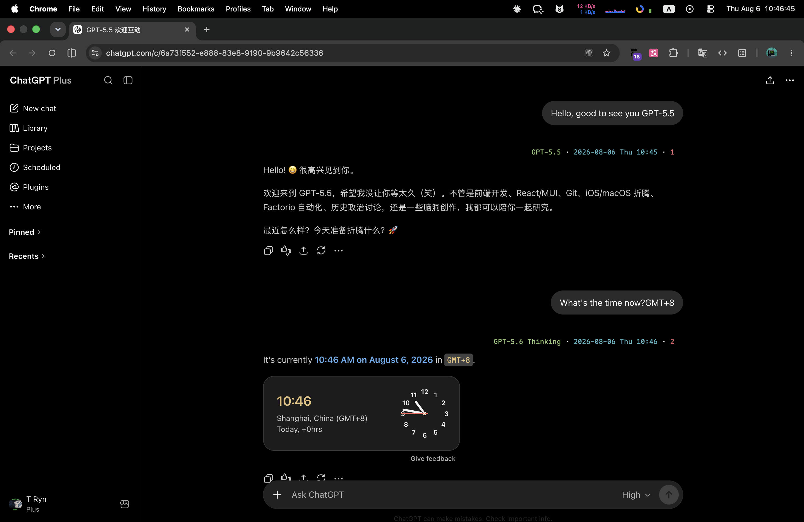

# ChatGPT Metadata Extension

A fork of [ChatGPT Timestamp Extension](https://github.com/Hangzhi/chatgpt-timestamp-extension) that displays metadata on ChatGPT assistant responses.

## Adds

- Assistant message index
- Assistant message timestamps in 24-hour format
- Assistant active model display
- Monospace metadata display
- _One dark_ / _Atom_ style

## Screenshot



<span style="font-size: 0.8rem; font-family: 'Maple Mono NF CN', 'JetBrains Mono', Menlo;"><span style="color:#98c379">GPT-5.6 Thinking</span><span style="color:#ffffff"> · </span><span style="color:#56b6c2">2026-08-06 Thu 10:46</span><span style="color:#ffffff"> · </span><span style="color:#e06c75">2</span></span>

## Manual install for Chrome

1. Download this repo
2. Open `chrome://extensions/`
3. Enable Developer mode
4. Load unpacked → select the `src/` folder
5. Visit ChatGPT

After changing the source, reload the extension in `chrome://extensions/` and refresh the ChatGPT tab. No build step is required.

## How metadata is loaded

The extension matches assistant message IDs in both legacy and redesigned ChatGPT pages. On the redesigned page, it locates React's committed component tree and validates the current conversation's live `renderedConversation.mapping` snapshot using the approach from [Hangzhi's September 2026 fix](https://github.com/Hangzhi/chatgpt-timestamp-extension/commit/bafbe3bc045e075eef0cef5bc19b89da74128383). It reads the selected final answer's timestamp and model from that snapshot. A reasoning or tool message does not supply the final answer's timestamp.

To determine global answer numbers, the extension requests ChatGPT's `/backend-api/conversations/{id}?include_has_versions=true&num_turns=100` endpoint. It reads the new `messages[]` response and loads older pages using `page_info.start_cursor` and `before` until the server confirms the start of history. On a 404, it tries the legacy `/backend-api/conversation/{id}` mapping endpoint. If authentication is required, it obtains the current session token from `/api/auth/session` and keeps it only in memory.

Answer numbers are calculated from the separately requested complete message history, grouping reasoning, tool calls, and final output after one prompt into one answer. The live rendered snapshot is not a source of global numbers: it can contain only a recent window, with its own synthetic root. Numbers do not depend on the currently mounted DOM or this render window. Explicitly partial responses, detached message roots, and missing ancestry mean the number is omitted rather than estimated. Missing timestamps and models are also omitted. The ability to recover a global number depends on ChatGPT making the complete selected history available. Reads are limited to 100 pages, 50,000 messages, and 60 seconds per attempt; incomplete or changing history does not receive an estimated number.

Home, temporary-chat, and shared pages without a `/c/{id}` URL may only have DOM model information. This implementation depends on ChatGPT's internal React state, conversation endpoint, and message attributes, which can change.

If metadata is missing, the page Console can report lookup counts without message text or tokens:

```js
window[Symbol.for('chatgpt-metadata-extension')]?.diagnostics();
```

## Local checks

Run `node --check src/content.js` and `node --test tests/content.test.cjs`. The regression tests use an in-memory DOM, clock, and API responses; they do not access a browser or the network and require no dependencies.
